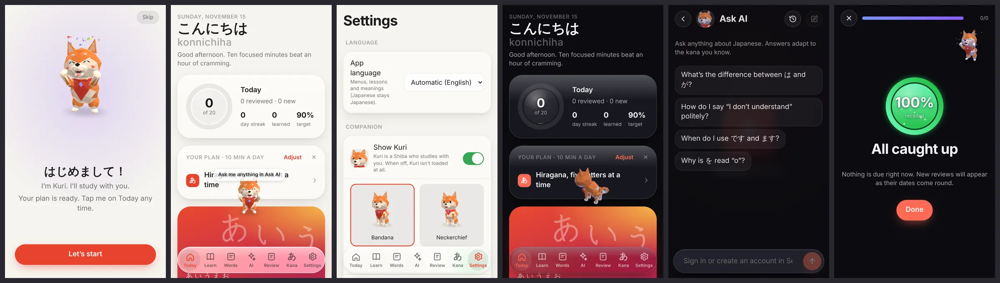

# Kuri, the Shiba companion

Kuri (栗, after the chestnut coat) is a low-poly Shiba who studies with you.

## Where Kuri appears

| Where | What Kuri does | Setting |
| --- | --- | --- |
| Today | Walks around the bottom of the screen, sits, dozes after 30s. Drag to move, tap for a hop and a line. Shake while holding (four quick back-and-forth swings) and Kuri gets dizzy: x x eyes, a wobbling head and stars circling, then a line when set down. | Walk around on Today |
| Ask AI | Avatar in the header; thinks while a reply streams. | Show Kuri |
| Lessons and reviews | Pops up in the corner for ~1.5s on a right (happy) or wrong (encourage) answer. | React to answers |
| First meeting | ~4s intro once: after onboarding, or the first time an existing user opens Today. Skippable; still with reduced motion. Replay from Settings. | Show Kuri |

All settings live in `progress.settings` (`kuri`, `kuriStyle`, `kuriWalk`, `kuriReact`, `kuriLowPoly`, `kuriSound`). The intro is marked seen in IDB `meta/kuriIntroSeen`.

## Sound

With **Sound** on (the default), Kuri yips on a tap, squeaks when picked up, sighs falling asleep, hums while Ask AI thinks, goes "awawawa" with twinkling stars when shaken dizzy, chirps or "awoo"s for right and wrong answers, and says "はじめまして！" in the first meeting.

- Everything is synthesized with Web Audio in `src/lib/companion/sound.ts` (under 2 KB gzipped). There are no audio files.
- The voice is built from scratch: a buzzing tone through vowel filters, one syllable at a time. It copies no recording or real voice.
- On iPhone and iPad (Safari 16.4+) the page's audio is marked `ambient`, so it follows the silent switch. Only there: on Mac Safari an `ambient` page played nothing at all (2026-11-21). Other browsers can't detect silent mode and play at the page volume.
- After the page has been in the background, the next tap builds a fresh AudioContext unless the old one is still running (iPhone leaves it `interrupted`, and an interrupted context can stay silent).
- Browsers lock audio until the first touch. `kuri.svelte.ts` unlocks it on the first tap while Sound is on, so nothing plays before the learner touches the app.
- Sound defaults to on. A stored `kuriSound` only counts once `kuriSoundChosen` is set (the learner flipped the switch); older saved settings that just carried the old `false` default get the new default.
- Use `kuriSound(name)` and `kuriHello()` from `kuri.svelte.ts`; they do nothing when Kuri or Sound is off.

## Files

| What | Where |
| --- | --- |
| Renderer and geometry (no dependencies) | `src/lib/companion/shiba.ts` |
| Types, settings helpers, reaction bus, sound helpers | `src/lib/companion/kuri.svelte.ts` |
| Synthesized sounds and voice | `src/lib/companion/sound.ts` |
| One Kuri on a canvas | `src/lib/companion/Kuri.svelte` |
| Today walker, intro, reaction, Settings section | `KuriWalker.svelte`, `KuriIntro.svelte`, `KuriReaction.svelte`, `KuriSettings.svelte` |

Call `kuriReact('happy' | 'encourage')` from a study screen to make Kuri react.

## Performance

- The renderer is a separate ~9 KB gzipped chunk, loaded with a dynamic import only when a Kuri is on screen. With Kuri off it's never downloaded.
- Full model ~1,500 triangles (~90 KB GPU); low poly ~950 (~57 KB). Small Kuris use low poly at 30 fps by default.
- One interleaved vertex buffer (20 bytes a vertex), no per-frame matrix allocations, hidden parts skipped.
- Drawing stops when the tab is hidden, when the canvas is off screen, and after one still frame with reduced motion. `destroy()` frees the buffer, shader and WebGL context when a screen unmounts.
- When the browser drops the WebGL context (Safari does after the app sat in the background, a sleep or memory pressure), `Kuri.svelte` replaces the canvas and builds Kuri again once the page is visible, at most 3 times a minute. `npm run check:render` checks it on Settings, and that shaking the Today Kuri makes it dizzy while a plain drag does not.
