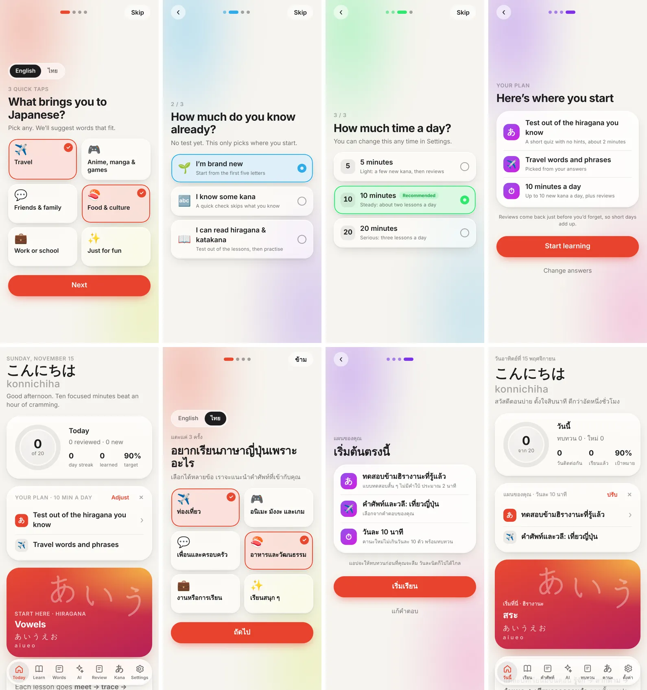

# First-run onboarding

Right after the introduction, before the beta sign-up (so it works signed out), new
installs get three tappable questions and the plan they produce.

| Question | Choices | Default (Skip) | What it sets |
|---|---|---|---|
| What brings you to Japanese? | Travel, Anime/manga/games, Friends & family, Food & culture, Work or school, Just for fun (pick any) | none | Topic course suggested in the plan (first pick wins) |
| How much do you know already? | Brand new · Some kana · Read hiragana & katakana | Brand new | Lesson 1, or the placement check (hiragana, then katakana) |
| How much time a day? | 5 · 10 · 20 minutes | 10 | `settings.newPerDay` 5 · 10 · 15 |

- Single-choice questions advance on tap. **Skip** is on every question and keeps the
  defaults without touching Settings. Back and "Change answers" let people revise.
- **Start learning** lands on Today (never inside a lesson), where the plan card links the first
  step; the beta sign-up shows on top. The same holds for `/invite` links and passkey sign-up.
- If the build has the interface language (`src/lib/i18n`), a language switch sits on the first
  question and the questionnaire switches live. Its copy (English + Thai) is in
  `src/lib/onboarding/strings.ts`; move it into `en.ts` / `th.ts` once i18n is merged.
- The placement check is offered only when `/learn/placement` exists in the build; otherwise
  everyone starts at lesson 1.

## Today plan card

`PlanCard.svelte` shows the plan on Today with each step ticked off (lesson done, any lesson
of that script passed, any card added from the course). **Adjust** reopens the questions with
the previous answers; ✕ hides it; it disappears when every step is done. Installs from before
onboarding (or people who skipped) see a small "Personalize" nudge until they've learned 10 kana.

## Storage

Answers live on the device in IndexedDB `meta/profile` (`{ goals, level, minutes, at, skipped, hidden? }`).
They are not synced; the pace they set is in Settings, which already travels with the device.
Mapping logic is pure and tested: `src/lib/onboarding/plan.ts`.
